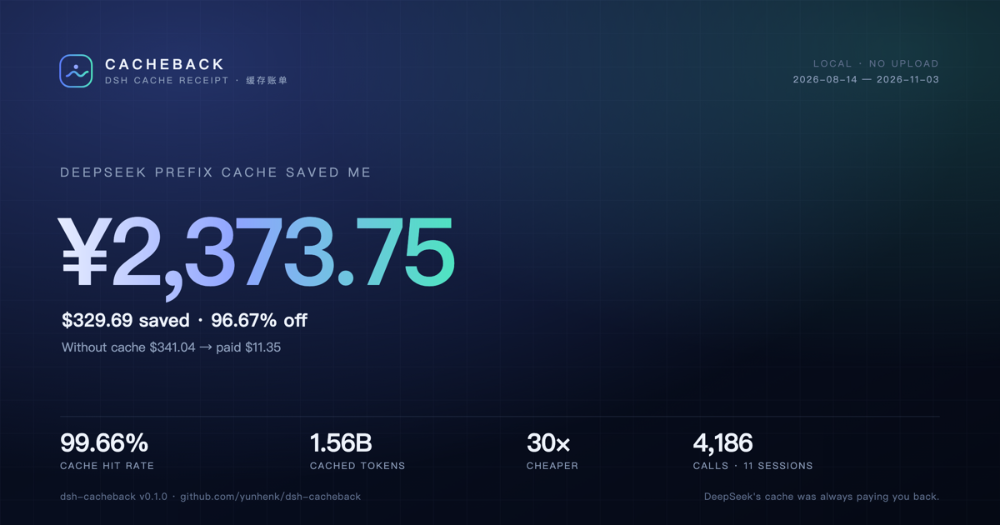

# Cacheback

**DeepSeek's prefix cache has been paying you back. Cacheback prints the receipt.**

<p align="center">
  <a href="https://github.com/yunhenk/dsh-cacheback"></a>
  <a href="LICENSE"></a>
  <a href="https://github.com/yunhenk/dsh-cacheback/actions/workflows/test.yml"></a>
  <a href="https://github.com/yunhenk/dsh-cacheback/releases"></a>
</p>

<p align="center">
  
</p>

Cacheback is a [DeepSeek Harness](https://github.com/deepseek-ai/deepseek-harness) plugin that turns the session
logs already on your disk into a line-by-line cache receipt. It replays every model call, prices it at DeepSeek's
published peak/off-peak rates, and answers one question:

> **How much did DeepSeek's prefix cache actually save me?**

On the machine this was built on: **1.57B cached tokens, a 99.66% cache hit rate, and ≈¥2,386 saved** — the same
prompts would have cost about 30× more at the cache-miss price. Project names are redacted in the screenshot; your
receipt uses your own workspace names.

English | [中文](README.zh.md)

## The 30-second version

A cache hit on `deepseek-flash` costs **$0.003 per 1M tokens** off-peak. A cache miss costs **$0.15** — **50× more**.
DSH already records both numbers for every call, but nothing puts them on one page. Cacheback does:

```text
Cacheback · DeepSeek cache receipt
2026-08-14 → 2026-11-03 · 11 sessions · 5 projects · 4,226 calls

DeepSeek prefix caching saved you ≈¥2,385.88 ($331.37).
Without cache $342.78 → you paid $11.41 · 30× cheaper · 99.66% hit rate

Spend: cache read $6.76 · cache miss $1.29 · output $3.35
Tokens: 1.57B hit · 5.3M miss · 3.64M out

Projects
  Project A            $185.55  ·  2,186 calls  ·  99.66%
  Project B             $70.53  ·  1,041 calls  ·  99.69%
  Project C             $68.86  ·    780 calls  ·  99.67%

What to improve
  · Peak premium: 2,119 calls ran at peak. Off-peak is half price.
  · 4 cold starts cost $0.14. Resume a session instead of starting a new one.
  · Output is 29.4% of the bill. Shorter answers cut the biggest line.
  · Keep the tool prefix stable: plugin changes rewrite the cached prefix.

Cache score 99.7 · S
```

Then make it shareable:

```text
/cache receipt   # self-contained HTML receipt, print to PDF
/cache card      # 1200×630 SVG card for X / GitHub / Slack
/cache 30d       # last 30 days only
/cache redact    # hide project names and paths before sharing
```

## Install

```sh
dsh plugin --profile web add github:yunhenk/dsh-cacheback
```

Or install from a local checkout while developing:

```sh
dsh plugin --profile web add link:/absolute/path/to/dsh-cacheback
```

The plugin has **zero runtime dependencies**, makes **zero network requests**, and reads only the session logs DSH
already writes. A restart (or HMR reload) makes `/cache` available.

**Or install from Discover.** Add this index source under **Plugins → Discover → Index sources**:

```text
https://raw.githubusercontent.com/yunhenk/dsh-cacheback/53d96752f562e5e5280e07733dcb2ee9d7869986/market/index.json
```

## What the receipt measures

| Figure | Meaning |
|---|---|
| **Saved** | What the same calls would have cost at the cache-miss price, minus what you actually paid. |
| **Cheaper** | No-cache cost ÷ actual cost. On a warm session this is usually 20–50×. |
| **Cache hit rate** | Cache-read tokens ÷ (cache-read + cache-miss) tokens. |
| **Peak premium** | Extra dollars paid because calls landed in DeepSeek's peak window (09:00–12:00 / 14:00–18:00 Beijing weekdays). Off-peak is half price. |
| **Cold starts** | Calls that began with an empty cache and paid the full miss price for the prefix. |
| **Spend split** | Cache read vs cache miss vs output. Output is often the surprise. |
| **Cache score** | Hit-rate score with a letter grade, plus the four tips with the largest impact. |

There is no sampling and no estimation of token counts: every number comes from the provider usage DSH persisted on
each `assistant/message`. Pricing uses the official table (see [docs/method.md](docs/method.md)), with the Chinese
public-holiday calendar applied to the peak window.

## Privacy

- **Local only.** Cacheback reads `~/.dsh/sessions` and writes receipts to `~/.dsh/cacheback`. It never opens a socket.
- **No telemetry.** No analytics, no “anonymous usage”, no remote font or image.
- **Share safely.** The SVG card contains aggregates only — no project names, session titles, or paths.
  `/cache redact` also replaces project names in the HTML receipt with `Project A/B/C…`.
- **Delete anytime.** Remove `~/.dsh/cacheback` and the plugin's profile entry. Session logs belong to DSH.

## How it works

1. **Discover** the newest `session*.jsonl(.zstd)` under every `~/.dsh/sessions/<project>/<session>/`.
2. **Decode** the append-only log. DSH writes one Zstandard frame per batch; Node's decoder stops after the first,
   so Cacheback splits on the frame magic and decodes every frame independently (torn trailing frames are skipped).
3. **Replay** each `assistant/message`: provider usage (`inputTokens`, `cacheReadTokens`, `cacheWriteTokens`,
   `outputTokens`), model id, and timestamp. Seeded/forked history is skipped so calls are never billed twice.
4. **Price** each call at the rate for its model and its Beijing-time window. Cache writes are billed as misses.
5. **Aggregate** by project, model, and day; compute the counterfactual, the score, and actionable tips.
6. **Render** the chat summary, a self-contained HTML receipt, or a 1200×630 SVG card.

Parsed sessions are cached in `~/.dsh/cacheback/index.json`, keyed by file size and mtime, so a repeat run only
re-reads sessions that changed.

## Accuracy and limits

- **Savings are a counterfactual.** “Saved” assumes the same prompt would otherwise have been sent without a cache
  hit. That is the standard way to quantify prefix-cache value; it is not a refund.
- **CNY is approximate.** DeepSeek bills in USD; the receipt shows `≈¥` at a configurable rate (default `7.2`).
- **Peak calendar is 2026.** The official 2026 State Council holiday list is included. Other years fall back to
  weekdays only; override with the plugin config if you need a different calendar.
- **Only DeepSeek calls are priced.** Calls from another provider are counted and reported as excluded, because
  their cache pricing is different.
- **Logs must still exist.** If you delete session history, its receipt line disappears with it.
- **Not a bill.** Provider dashboards and invoices remain the source of truth; this is a local, auditable receipt.

## Configuration

The plugin accepts optional config through the profile patch:

```yaml
- id: cacheback
  config:
    usdToCny: 7.2
    lang: zh          # zh | en, default for the chat summary
    open: false       # open generated receipts in the browser by default
```

| Key | Default | Meaning |
|---|---|---|
| `usdToCny` | `7.2` | Display conversion for the approximate CNY figure. |
| `lang` | `zh` | Default language for the chat summary; the HTML receipt and card are bilingual. |
| `open` | `false` | Open generated files in the default browser. `/cache receipt` opens explicitly. |

## Development

```sh
git clone https://github.com/yunhenk/dsh-cacheback
cd dsh-cacheback
node --test test/*.test.js
```

The test suite covers the pricing calendar, cache-write accounting, multi-frame Zstandard decoding, seeded-history
deduplication, redaction/escaping, command parsing, and the HTML/SVG renderers. No model calls, no network.

See [docs/method.md](docs/method.md) for the exact formulas and event schema.

## For the DSH team

If you run DSH support, growth, or community: Cacheback is a local, privacy-preserving answer to *“is the cache
working, and why is my bill high?”* It needs no telemetry, no server, and no account. Point a user at `/cache`; the
share card tells an accurate, positive cache-value story with numbers from their own machine.

## License

MIT. Built for the DSH plugin ecosystem.
