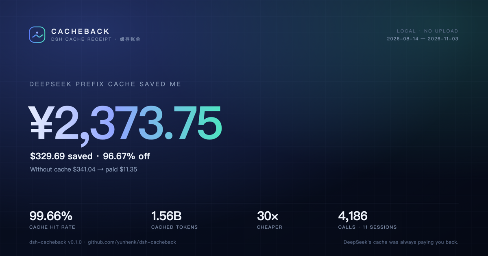

# Cacheback · 缓存返现

**DeepSeek 的前缀缓存一直在替你省钱。Cacheback 把账单打出来。**

<p align="center">
  <a href="https://github.com/yunhenk/dsh-cacheback"></a>
  <a href="LICENSE"></a>
  <a href="https://github.com/yunhenk/dsh-cacheback/actions/workflows/test.yml"></a>
  <a href="https://github.com/yunhenk/dsh-cacheback/releases"></a>
</p>

<p align="center">
  
</p>

Cacheback 是一个 [DeepSeek Harness](https://github.com/deepseek-ai/deepseek-harness) 插件。它读取 DSH 本来就在写的会话日志，逐笔回放每一次模型调用，按 DeepSeek 官方峰谷价重新计费，然后回答一个问题：

> **DeepSeek 的前缀缓存，到底替我省了多少钱？**

在这台开发机上：**15.7 亿缓存命中 tokens、99.66% 命中率、省下约 ¥2,386**。同样的 prompt 如果全部按未命中价重读，大约要贵 30 倍。截图里的项目名已脱敏，你自己跑出来的账单会用真实项目名。

[English](README.md) | 中文

## 30 秒版

`deepseek-flash` 的缓存命中价是 **$0.003 / 1M tokens**（谷时），未命中价是 **$0.15 / 1M**——**差 50 倍**。DSH 的日志里本来就记着每一笔命中和未命中，只是没有一个地方把它们放在一页上。Cacheback 就是那一页：

```text
Cacheback · DeepSeek 缓存账单
2026-08-14 → 2026-11-03 · 11 个会话 · 5 个项目 · 4,226 次调用

DeepSeek 前缀缓存为你省下 ≈¥2,385.88（$331.37）。
没有缓存 $342.78 → 实际 $11.41 · 便宜 30× · 命中率 99.66%

花费构成：缓存读取 $6.76 · 未命中 $1.29 · 输出 $3.35
Tokens：命中 1.57B · 未命中 5.3M · 输出 3.64M

项目
  Project A            $185.55  ·  2,186 次  ·  99.66%
  Project B             $70.53  ·  1,041 次  ·  99.69%
  Project C             $68.86  ·    780 次  ·  99.67%

可优化
  · 峰时溢价：2,119 次调用落在峰时。谷时价格直接减半。
  · 冷启动 4 次，花了 $0.14。续用会话，别每个任务都新开。
  · 输出占账单 29.4%。回答短一点，砍掉最大的一块。
  · 保持工具前缀稳定：装/卸插件会重写缓存前缀。

缓存评分 99.7 · S
```

再把它变成能发出去的东西：

```text
/cache receipt   # 自包含 HTML 账单，可打印成 PDF
/cache card      # 1200×630 SVG 分享卡，适合 X / 朋友圈 / Slack
/cache 30d       # 只看最近 30 天
/cache redact    # 分享前隐藏项目名和路径
```

## 安装

```sh
dsh plugin --profile web add github:yunhenk/dsh-cacheback
```

本地开发时也可以直接链一个 checkout：

```sh
dsh plugin --profile web add link:/absolute/path/to/dsh-cacheback
```

插件**没有运行时依赖**，**不发起任何网络请求**，只读 DSH 已经写好的会话日志。重启（或 HMR 重载）后 `/cache` 就能用。

**也可以从 Discover 装。** 在 **Plugins → Discover → Index sources** 添加：

```text
https://raw.githubusercontent.com/yunhenk/dsh-cacheback/068d5079ffe917746698adf523f9cf9b7558a9c9/market/index.json
```

## 账单里有什么

| 指标 | 含义 |
|---|---|
| **省下** | 同样的调用如果按未命中价计费要花多少，减去实际花费。 |
| **便宜倍数** | 无缓存成本 ÷ 实际成本。热会话通常是 20–50 倍。 |
| **缓存命中率** | 缓存读取 tokens ÷（缓存读取 + 未命中）tokens。 |
| **峰时溢价** | 因为落在峰时（北京时间工作日 09:00–12:00 / 14:00–18:00）而多付的钱。谷时半价。 |
| **冷启动** | 从空缓存开始、按未命中价重读整个前缀的调用。 |
| **花费构成** | 缓存读取 / 未命中 / 输出。输出经常是意外的大头。 |
| **缓存评分** | 按命中率打的 0–100 分 + 等级，外加影响最大的四条建议。 |

没有采样，也不估算 token：每个数字都来自 DSH 在 `assistant/message` 里持久化的 provider usage。定价用官方价目表（见 [docs/method.md](docs/method.md)），峰时窗口按中国政府公布的 2026 年节假日日历排除。

## 隐私

- **只在本地。** Cacheback 读 `~/.dsh/sessions`，把账单写到 `~/.dsh/cacheback`。不打开任何 socket。
- **没有埋点。** 没有 analytics，没有“匿名使用统计”，没有远程字体或图片。
- **分享安全。** SVG 分享卡只有聚合数字——没有项目名、会话标题或路径。`/cache redact` 还会把 HTML 账单里的项目名替换成 `Project A/B/C…`。
- **随时可删。** 删掉 `~/.dsh/cacheback` 和 profile 里的插件条目即可。会话日志属于 DSH。

## 怎么算的

1. **发现** `~/.dsh/sessions/<project>/<session>/` 下最新的 `session*.jsonl(.zstd)`。
2. **解码** append-only 日志。DSH 每批写一个 Zstandard frame，Node 自带的解码器只解第一帧；Cacheback 按 frame magic 切开逐帧解码，尾部写了一半的 frame 直接跳过。
3. **回放** 每条 `assistant/message`：provider usage（`inputTokens`、`cacheReadTokens`、`cacheWriteTokens`、`outputTokens`）、模型 id、时间戳。fork/seed 继承来的历史会跳过，避免重复计费。
4. **计价** 按模型和北京时间的峰谷窗口逐笔定价。cache write 按 miss 价计。
5. **聚合** 按项目、模型、天汇总；算反事实成本、评分和建议。
6. **渲染** 聊天摘要、自包含 HTML 账单、1200×630 SVG 分享卡。

解析结果缓存在 `~/.dsh/cacheback/index.json`，按文件大小和 mtime 失效，所以第二次运行只重读变化的会话。

## 准确性与边界

- **“省下”是反事实。** 假设同样的 prompt 没有命中缓存、必须按 miss 价重读。这是衡量前缀缓存价值的标准口径，不是退款。
- **人民币是近似值。** DeepSeek 按美元计费；账单按可配置汇率（默认 `7.2`）显示 `≈¥`。
- **峰时日历是 2026 年。** 内置国务院 2026 年节假日安排；其他年份只按工作日判断，可在配置里覆盖。
- **只给 DeepSeek 调用计价。** 其他 provider 的调用会计数并标注“已排除”，因为它们的缓存定价不同。
- **日志删了，账也就没了。** 这是本地回放，不是云端账单。
- **不是发票。** 官方控制台和账单仍是最终依据；Cacheback 是本地、可审计的收据。

## 配置

可以在 profile patch 里覆盖：

```yaml
- id: cacheback
  config:
    usdToCny: 7.2
    lang: zh          # zh | en，聊天摘要默认语言
    open: false       # 生成账单后是否自动打开浏览器
```

| 配置 | 默认 | 说明 |
|---|---|---|
| `usdToCny` | `7.2` | 人民币显示汇率。 |
| `lang` | `zh` | 聊天摘要默认语言；HTML 账单和分享卡是中英双语的。 |
| `open` | `false` | 生成后自动打开文件；`/cache receipt` 会显式打开。 |

## 开发

```sh
git clone https://github.com/yunhenk/dsh-cacheback
cd dsh-cacheback
node --test test/*.test.js
```

测试覆盖：峰谷日历、cache write 计费、多帧 Zstandard 解码、seed 历史去重、脱敏与转义、命令解析、HTML/SVG 渲染。不调用模型，不联网。

精确公式和事件结构见 [docs/method.md](docs/method.md)。

## 给 DSH 团队

如果你在做 DSH 的支持、增长或社区：Cacheback 是「缓存有没有在工作、账单为什么高」的本地答案。不需要埋点、不需要服务器、不需要账号。让用户敲一次 `/cache`，分享卡就是一份准确、正向、来自他自己机器的缓存价值说明。

## License

MIT。为 DSH 插件生态而做。
